<div align="center">

<!-- Animated header -->


<!-- Typing effect -->
<a href="https://git.io/typing-svg">
  
</a>

<br/>

<!-- Socials -->
<a href="https://www.linkedin.com/in/osamah-ashraf-182a72253"></a>
<a href="mailto:osamahashrafcwork@gmail.com"></a>
<a href="https://www.nuget.org/profiles/osamah"></a>


<br/><br/>


</div>

##  whoami

```csharp
public sealed record Osamah : IEngineer
{
    public string   Location  => "Lahore, Pakistan";
    public string[] Languages => ["C#", "TypeScript", "SQL"];
    public string[] Builds    => ["APIs", "microservices", "event-driven systems", "developer tools"];
    public string[] Cloud     => ["Azure Functions", "App Service", "Service Bus", "Entra ID"];

    public string CurrentlyExploring =>
        "Agent security, resilience patterns, and Roslyn analyzers";

    public async Task<Coffee> DebugAsync(Bug bug, CancellationToken ct = default)
    {
        while (!bug.IsFixed)
            await Task.WhenAll(ReadLogsAsync(ct), QuestionLifeChoicesAsync(ct));

        return new Coffee(Size.Large);
    }
}
```

<div align="center">

</div>

##  Tech arsenal

<div align="center">


<br/><br/>


</div>

<div align="center">

</div>

##  GitHub in motion

<div align="center">




<br/>


</div>

##  The snake eats my commits

<div align="center">
<picture>
  <source media="(prefers-color-scheme: dark)" srcset="https://raw.githubusercontent.com/Osamah3/Osamah3/output/github-contribution-grid-snake-dark.svg"/>
  <source media="(prefers-color-scheme: light)" srcset="https://raw.githubusercontent.com/Osamah3/Osamah3/output/github-contribution-grid-snake.svg"/>
  
</picture>
</div>

<details>
<summary><b>⚡ Fun facts.exe</b></summary>
<br/>

- 🧠 I name variables carefully and commit messages less carefully.
- 🐛 My favourite bug is the one that disappears when I add a log line.
- ☁️ If it can be an Azure Function, I've probably considered making it one.
- 🌙 Best code gets written after midnight. Best fixes happen the next morning.

</details>

<div align="center">


</div>
